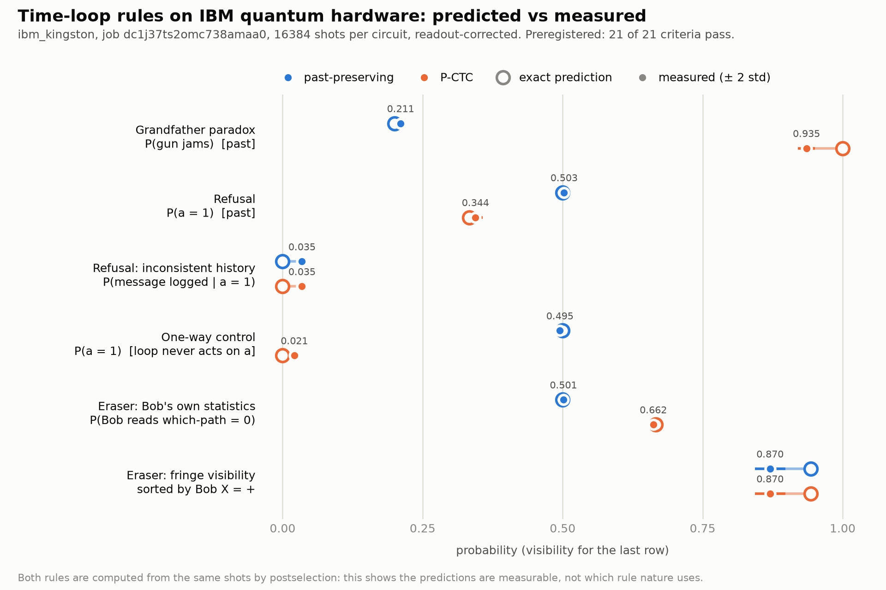
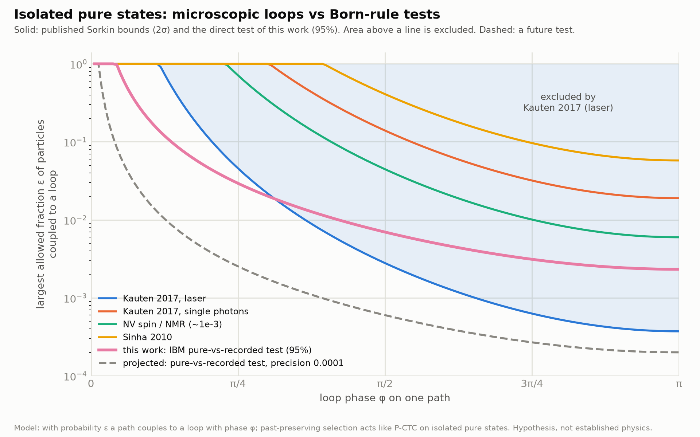

# Causal Loops Lab

**Exact toy models of information sent around a closed timelike curve (CTC), what self-consistency would do to the future, and experimental tests on IBM quantum hardware.**

[](ctc/README.md)
[](ctc/hardware/README.md)
[](ctc/born_rule/README.md)
[](ctc/README.md)
[](LICENSE)
[](LICENSES.md)
[](ROADMAP.md)
[](#honesty-statement)

[Roadmap](ROADMAP.md) · [Hypotheses](HYPOTHESIS.md) · [Theorems](ctc/THEOREMS.md) · [Hardware runs](ctc/hardware/README.md) · [Loop search](ctc/born_rule/README.md) · [Code and results](ctc/README.md) · [Outside perspectives](PERSPECTIVES.md)

## The question

If a message could be sent back in time, and the universe only allowed self-consistent histories, would the grandfather paradox disappear? And would the loop then show up as *changed statistics in the future*?

This project turns that idea into three testable hypotheses and checks them against the two standard quantum models of time travel, Deutsch's **D-CTC** (1991) and Lloyd et al.'s postselected **P-CTC** (2011), plus Allen's transition-probability **T-CTC** (2014) and a classical two-parameter family with D-CTC and P-CTC as corners.

| | Hypothesis | Plain words |
|---|---|---|
| H1 | Information sent to the past is always self-consistent | Paradoxical histories simply do not happen |
| H2 | The loop's observable effect appears in the future | Statistics after the loop differ from a world without it |
| H3 | Causality is global consistency | Without a loop, H1 reduces to ordinary cause-before-effect |

## Main findings so far

<picture>
  <source media="(prefers-color-scheme: dark)" srcset="ctc/output/hardware_results_dark.png">
  
</picture>

**What the models show**

1. **H2 needs an extra assumption: the universe must prefer consistent branches.** With no consistency selection (β = 0), the world's probabilities never change, wherever the message comes from. ([details](ctc/BRANCHES.md))
2. **Reweighting the world is the same thing as faster-than-light signalling.** In every rule tested, whenever the loop reweights Alice's world, Alice can signal to a distant Bob who shares correlations with her. Only non-reweighting rules are safe ([no-signalling map](ctc/output/signalling_map.png): zero only along s = 0). ([details](ctc/NO_SIGNALLING.md))
3. **Different selection rules give opposite answers.** Lloyd's gun never fires under P-CTC, but fires with probability sin²(θ/2) under D-CTC. ([details](ctc/LITERATURE_REPRODUCTION.md))
4. **In quantum mechanics "consistent" has two incompatible meanings.** Two logically consistent histories can cancel by interference, deleting a whole branch. ([details](ctc/QUANTUM_EFFECTS.md))
5. **An unconditional message looks exactly like an ordinary one.** From the receiver's side alone you cannot tell whether a message came from the future. ([details](ctc/README.md))

**A rule that keeps all three hypotheses**

6. **Past-preserving selection (PPS).** Recorded past facts keep their probabilities; consistency selection acts only inside each recorded past world. It is an ordinary quantum channel, so it can never signal. Which basis counts as "recorded" was the main open problem. Theorem 4 answers most of it: the record basis is the basis in which the outside world actually read Alice's input (fixed by the interaction, not the state), and with it PPS provably cannot signal; three other definitions of "the past" are shown to signal. Incompatible readouts (the last one counts) and coarse readouts (the loop acts inside each block) are handled too. For weak records two safe rules remain, one all-or-nothing and one continuous, and no principle found so far picks between them. One consequence: in a delayed-choice eraser the idler's CNOT reads the path in Z, so the loop acts like a which-path measurement; the earlier picture of an effect hidden in idler-sorted fringes belongs to an X-basis variant that Theorem 4 does not support. ([details](ctc/PAST_PRESERVING.md), [Theorem 4](ctc/THEOREMS.md))
7. **Under PPS, all three hypotheses hold as theorems, in a modified form (H1′–H3′).** Every recorded world is self-consistent (a definite consistent history when one exists, Deutsch's mixed fixed point otherwise); the loop never changes recorded past probabilities, and inside each past world it conditions the future on consistency; when the loop does not act back, ordinary quantum mechanics is recovered exactly. The original H3 fails under P-CTC: a bit that merely controls the loop still has a branch deleted. Each theorem is checked on random circuits. ([theorems](ctc/THEOREMS.md))
8. **PPS also works in a timeless universe and in spacetime, if "past" means "outside the loop's causal future".** Written as a constraint on a static Page–Wootters state (time is only a clock reading), PPS gives exactly the same predictions. Defining the past by clock order fails: swapping two commuting steps, i.e. reading the same physics with another clock, makes PPS collapse to P-CTC. Defining it as "records the loop cannot influence" works under every clock, including separate local clocks for two labs (frames that disagree on which event came first) and a clock in quantum superposition. In spacetime (qubits on worldlines, contact events, light cones; flat in 1–3 dimensions and a black hole) the past is everything outside the loop's causal future, with Theorem 4's record basis: then PPS provably changes nothing outside that future on any slice (Theorem 5), while P-CTC even lets information out of a black hole. The loop can also be made by time dilation, as a wormhole time machine (one mouth makes a twin-paradox trip; light clocks simulate the dilation): there P-CTC changes a record that no causal curve, through the wormhole or not, connects to the loop, and PPS does not. Slicing by simultaneity and using the causal past both signal; protecting uninfluenced records inside the future cone lets a later choice change earlier statistics. ([timeless](ctc/timeless/README.md))
9. **PPS is not entirely new, and it is computationally strong.** Its rule inside each world is Hartle's 1994 conditional probability (Eq. 5.6); PPS differs from Hartle's framework only by not reweighting the recorded past. On definite inputs it equals P-CTC, so it inherits P-CTC's PostBQP computational power: it cannot signal, but in principle it could solve NP-complete problems, which counts against it as physics. ([novelty](ctc/NOVELTY_CHECK.md), [perspectives](PERSPECTIVES.md))

**What the experiments show**

10. **The predictions are measurable on real quantum hardware.** Postselected-teleportation circuits on IBM's `ibm_kingston` (figure above) reproduce every predicted effect: P-CTC changes the recorded past and a distant partner's statistics, PPS does not, inconsistent histories are suppressed to 3.5%, and, for the X-basis variant of PPS, the loop's effect in a delayed-choice eraser appears only in Bob-sorted fringes (visibility 0.870, shift 0.774 rad vs 0.785 predicted; Theorem 4 later favoured the Z basis, see finding 6). Predictions and pass criteria were written down before the run and 21 of 21 pass; the preregistration has no external timestamp, since it was committed together with the results. These are ordinary quantum circuits whose outcomes standard quantum mechanics fixes in advance, and every rule is computed from the same shots, so the runs test the hardware, not the rules. Earlier hardware work on postselected CTCs includes photonic experiments (Lloyd et al. 2011; Ringbauer et al. 2014, D-CTC) and a 2025 experiment on IBM and Quantinuum processors (arXiv:2501.16335). ([hardware runs](ctc/hardware/README.md))
11. **No sign of microscopic loops in nature.** If loops coupled to isolated quantum states, an unrecorded superposition would have shifted probabilities compared with a recorded one. A preregistered direct test on `ibm_kingston` finds no shift: |S| < 1.16×10⁻³ (95%). In a model where every particle couples to a loop, the loop phase must be below 0.136 rad, a stronger bound than published three-slit data for phases between 0.14 and 0.98 rad. A first run's 10σ "anomaly" turned out to be CNOT crosstalk, exposed by a preregistered control: IBM compiles +π/2 and −π/2 into the same physical pulse, so the planned symmetry cancellation never happened. ([loop search](ctc/born_rule/README.md))

<picture>
  <source media="(prefers-color-scheme: dark)" srcset="ctc/output/born_rule_bounds_dark.png">
  
</picture>

12. **Two intuitive conjectures about PPS are false.** In a "conjecture lottery", credences were fixed and hashed before any checking code existed, then 11 open conjectures were settled by exhaustive enumeration (all 40320 classical reversible circuits, all 11520 two-qubit Cliffords) or counterexample search. "PPS never acts more strongly than P-CTC" holds for one-qubit systems but fails for two; "PPS never increases entropy" fails. ([conjecture lottery](ctc/conjectures/README.md))

**Novelty status.** Findings 2–4 are already known in the literature (Bub & Stairs 2014; Araújo, Guérin & Baumeler 2017; Lloyd et al. 2011), and the code reproduces them independently. PPS's within-world rule is Hartle 1994. What may be new: PPS as a causal modification of Hartle's framework with the theorems H1′–H3′; the κ–β family interpolating D-CTC and P-CTC (closest prior work: Allen's T-CTC, reproduced [here](ctc/T_CTC.md)); and the direct pure-vs-recorded Born-rule bound. None of this is confirmed by experts. See [ctc/NOVELTY_CHECK.md](ctc/NOVELTY_CHECK.md).

## Quick start

Requires Python 3.11+ and NumPy; figures need matplotlib.

```bash
python -B ctc/tests/test_models.py
python -B ctc/tests/test_theorems.py
python -B ctc/tests/test_past_preserving.py
python -B ctc/tests/test_signalling.py
python -B ctc/run_signalling.py           # regenerates the no-signalling map
```

[ctc/README.md](ctc/README.md) lists all 24 test files (269 tests) and every script. Every model is a small exact calculation (1–6 qubits); results are checked against closed-form formulas and against the published numbers in Lloyd et al. 2011, Brun, Harrington & Wilde 2009, Allen 2014 and Hartle 1994.

The hardware experiments need `qiskit` (and `qiskit-ibm-runtime` plus your own IBM Quantum account for real devices):

```bash
python -B ctc/hardware/run_local.py       # ideal simulator, full analysis
python -B ctc/hardware/preregister.py     # fix predictions and criteria before a run
python -B ctc/hardware/run_ibm.py --dry-run
python -B ctc/hardware/plot_results.py    # regenerates the figure above
python -B ctc/born_rule/compare.py        # regenerates the loop-search figure
```

## Repository layout

| Path | Content |
|---|---|
| [HYPOTHESIS.md](HYPOTHESIS.md) | precise statements of H1–H3, and how they relate to the proved H1′–H3′ |
| [ROADMAP.md](ROADMAP.md) | findings, phases, risks and corrected errors |
| [LITERATURE_REVIEW.md](LITERATURE_REVIEW.md) | where the project sits in the P-CTC / D-CTC literature, with reading levels |
| [PERSPECTIVES.md](PERSPECTIVES.md) | an outside reading: three layers of claims, open problems, suggestions |
| [ctc/](ctc/README.md) | models, theorems, tests and figures |
| [ctc/hardware/](ctc/hardware/README.md) | IBM runs of the loop rules |
| [ctc/born_rule/](ctc/born_rule/README.md) | search for microscopic loops via Born-rule tests |
| [ctc/conjectures/](ctc/conjectures/README.md) | conjecture lottery |
| [ctc/blockchain/](ctc/blockchain/README.md) | a Bitcoin-anchored self-consistency lottery (designed, not run) |
| [ctc/invitation/](ctc/invitation/README.md) | an invitation to anyone with a time machine to send back a Bitcoin block hash before the block is mined (designed, not published) |

## Honesty statement

- This project does **not** claim that information can be sent to the past, and no simulation could show that: postselected simulations can always be explained in the normal time direction.
- The IBM runs of the loop rules implement them by postselection, and their outcomes follow from standard quantum mechanics. They show that each rule's predictions can be measured on a real device; they do not show that loops exist or which rule nature would use.
- The direct Born-rule test is a genuine test of a hypothesis beyond standard quantum mechanics; it found nothing, and its bound applies to one class of loop models (Z-basis coupling).
- It does not support any personal time-travel claim.
- Code and writing used AI assistance (Claude). There has been **no external peer review**. Corrections and expert feedback are very welcome: please open an issue.

## Contributing

Useful contributions right now:

- Pointers to prior work on the causal version of Hartle's rule (past-preserving selection), or on rule families interpolating D-CTC and P-CTC.
- A record basis fixed by the system–environment interaction rather than the state (see [PERSPECTIVES.md](PERSPECTIVES.md), 3.1).
- A quantum version of the κ–β model with a decoherence parameter.
- Reformulating H1–H3 in the process-matrix framework.
- Replicating the hardware experiments on another device.

Open an issue or a pull request. If you use this work, GitHub's "Cite this repository" button gives the citation from [CITATION.cff](CITATION.cff).

## History

The repository started as an evidence package for two earlier research proposals (a finite SYK information-transfer model, and uncertainty and cost checks for small quantum experiments). It was renamed and refocused on this research on 2026-11-22. On 2026-11-24 the earlier package was removed from the main tree; it is preserved, with its hash manifest and verification script, at the git tag `archive/evidence-package-v0.34`.
