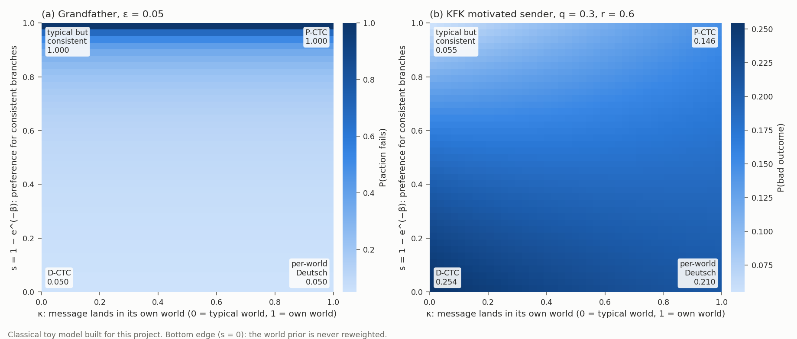

# Weighted branches: the κ–β model (classical version)

Created 2026-11-22 with AI assistance (Claude). This model was constructed in this project, not taken from the literature, and has not been externally reviewed.

```text
python -B ctc/tests/test_branches.py   # 8 tests
python -B ctc/run_branches.py          # writes output/branches_map.csv and output/branches_map.png
```

The code is in [branches.py](branches.py).

## Model

A **branch** (one history) consists of the world's random input x (prior P0(x)) and the message m received from the loop. The dynamics are deterministic: in branch (x, m) the message f(x, m) is sent back and the outcome y(x, m) is left behind.

Branch weights are set by two knobs.

**κ: where the message comes from.** A message sent from branch (x, m) lands in the same world x with probability κ, and in a fresh world drawn from P0 with probability 1 − κ. The long-run distribution of this "hopping chain" (the Cesàro limit starting from P0(x) × uniform) is the prior weight w0(x, m).

- κ = 0: the message comes from a typical world and is independent of the receiver's world.
- κ = 1: each world receives only its own message.

**β: how strongly the universe prefers consistent branches.** The weight is w(x, m) ∝ w0(x, m) × exp(−β d), where d is the number of bits in which the sent and received messages differ.

- β = 0: no selection.
- β = ∞: inconsistent branches have weight zero.

The vertical axis of the figure uses s = 1 − e^{−β}, so s = 0 means no selection and s = 1 full selection.

## The four corners

| Corner | κ | β | Meaning | Check |
|---|---|---|---|---|
| D-CTC | 0 | 0 | message from a typical world, no selection | tested: equals quantum D-CTC on the circuits in `circuits.py` |
| P-CTC | 1 | ∞ | message returns to its own world, only consistent branches survive | tested: equals quantum P-CTC on these circuits (measurement probabilities only, not coherences) |
| Per-world Deutsch (new) | 1 | 0 | each world only requires its own message to be statistically consistent | closed form derived here |
| Typical but consistent (new) | 0 | ∞ | message from a typical world, only consistent branches survive | closed form derived here |

A detail at the P-CTC corner: in general the κ = 1, β = ∞ corner weights each consistent message by its basin of attraction within the world, whereas P-CTC gives every consistent message the same weight. The two agree only when those weights coincide. All three circuits in this project are such cases, but it is not a general theorem.

## Results



| Scenario | D-CTC | Per-world Deutsch | Typical but consistent | P-CTC |
|---|---|---|---|---|
| Grandfather paradox, ε = 0.05: P(action fails) | 0.050 | 0.050 | 1.000 | 1.000 |
| KFK motivated sender, q = 0.3, r = 0.6: P(bad outcome) | 0.254 | 0.210 | 0.055 | 0.146 |

Closed forms (all verified by tests):

- Grandfather paradox: P(fail) = ε / (ε + (1 − ε) e^{−β}), **independent of κ**.
- KFK, per-world Deutsch: q(1 − r/2).
- KFK, typical but consistent: q(1 − r)π / ((1 − q)(1 − π) + q(1 − r)π), where π = q / (1 + qr) is the probability of receiving the warning under D-CTC.

## Main findings

1. **No selection, no reweighting.** Along the whole bottom edge β = 0, for any κ, the world's prior P0(x) is unchanged (test `test_world_prior_is_untouched_when_beta_is_zero`). The grandfather paradox always fails with probability ε. So **H2, "the loop's effect shows up in future statistics", needs β > 0**: an explicit physical assumption that the universe prefers consistent branches.
2. **The grandfather paradox depends only on β, not on κ.** In this circuit the failure probability is set by the selection strength alone, wherever the message comes from.
3. **In the KFK scenario both knobs matter, and not monotonically.** The lowest bad-outcome probability (0.055) is at the new "typical but consistent" corner, not at P-CTC. A message from another world, combined with selection of consistent branches, suppresses the bad outcome more than a message returning to its own world.
4. **An unconditional sender is the same everywhere on the plane**, q(1 − r): there is no paradox to resolve, so neither knob has any effect.

## Limitations

- Classical only: messages are bits, the world's randomness is ordinary probability, and the dynamics are 0/1 permutations. `branches.py` refuses circuits with phases, because quantum P-CTC then shows interference the classical model cannot see ([QUANTUM_EFFECTS.md](QUANTUM_EFFECTS.md)). A quantum version must track coherences, since P-CTC adds the **amplitudes** of consistent histories; for example the coherence ⟨X⟩ = 1 that P-CTC gives in the bootstrap paradox is invisible here.
- The soft penalty exp(−β × number of differing bits) is the simplest choice and has no physical derivation.
- The hopping chain for κ is one way to interpret "which world the message comes from", not the only one.
- We do not know whether the same two-parameter model exists in the literature. The literature review read mostly abstracts, so this only means "not found".
