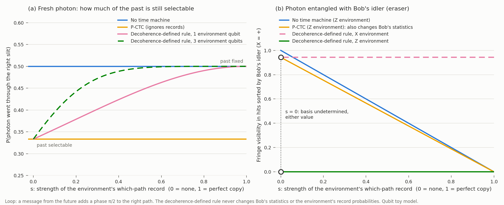

# 用去相干決定「記錄基底」

建立日期：2026-11-22，撰寫時使用 AI 輔助（Claude）。規則是本專案提出的候選，新穎性沒有檢查。沒有外部審查。

```text
python -B ctc/tests/test_decoherence.py   # 6 項測試
python -B ctc/run_decoherence.py          # 產生 output/decoherence.json 和 output/decoherence.png
```

程式在 [decoherence.py](decoherence.py)。前一步見 [PAST_PRESERVING.md](PAST_PRESERVING.md)。

## 問題

過去守恆篩選需要知道哪個基底算「已記錄的過去」。在糾纏的雙縫實驗裡，Z 和 X 兩個選擇同樣合理，卻給出不同的預測。這裡試著讓環境來決定：**被環境記錄下來的，才算過去。**

## 模型

- 光子路徑 S（左縫 |0⟩、右縫 |1⟩）。
- Bob 的閒置光子 B（可選）：用 CNOT 複製路徑。
- 環境 E：一到三個量子位元，各自對路徑做**部分**記錄：|a⟩|0⟩ → |a⟩|E_a⟩，⟨E_0|E_1⟩ = 1 − s。s = 0 表示完全沒記錄，s = 1 表示完美複製。環境可以監測 Z（路徑）或 X。
- 以上都發生在迴圈之前。然後迴圈把一個來自未來的位元送回來，在右邊路徑加上 π/2 的相位。

## 去相干定義的規則

1. **世界**：用環境的讀取基底讀出的每個結果 e。每個世界的機率固定不變，因為環境的紀錄就是過去。
2. **在世界 e 裡，S 的記錄基底**：S 的條件狀態 ρ_{S|e} 的本徵基底。計算時把 Bob 的閒置光子 trace 掉，因為它屬於 Bob，他之後還可以擦除。
3. 在這個基底上做過去守恆篩選。

規則用到的東西（世界的切分和基底）只取決於 S 和環境的狀態，Bob 改變不了；在每個世界裡它又是 S 上的普通通道。所以**它不能傳訊**，兩個方向都不能。測試涵蓋兩種環境基底、四種記錄強度、兩種 p，以及兩個環境量子位元的情況。

## 結果 1：新鮮的光子，過去有多少是固定的

光子跟誰都沒有糾纏，只有環境在記錄它的路徑（監測 Z）。



| 記錄強度 s | 無時光機 | P-CTC | **去相干定義的規則** |
|---|---|---|---|
| 0（沒有記錄） | 0.5 | 1/3 | **1/3**，過去完全可被選擇 |
| 0.1 | 0.5 | 1/3 | **0.356** |
| 0.5 | 0.5 | 1/3 | **0.444** |
| 1（完美記錄） | 0.5 | 1/3 | **0.5**，過去完全固定 |

表中是 P(光子走右縫)。一個環境量子位元的閉式解是：

```text
P(右縫) = d²/2 + (1 + c²)/2 · c²/(2 + c²)，   c = 1 − s，d² = 1 − c²
```

- **這回答了上次的問題：** 去相干的程度，連續地決定了過去有多少是固定的、有多少還能被未來選擇。
- **紀錄越多份，過去固定得越快：** 三個環境量子位元時，s ≈ 0.5 就幾乎完全固定（圖 a 的綠色虛線）。這跟 Zurek 的「量子達爾文主義」直覺一致：被多份複製的資訊，才是客觀的過去。
- **P-CTC 會改寫環境的紀錄：** s = 1 時，環境記錄的「走右縫」機率從 1/2 被改成 1/3。如果環境的一部分在遠方，這就是傳訊。去相干定義的規則從不改寫紀錄的機率（測試確認）。

## 結果 2：量子擦除，基底由誰監測決定

光子跟 Bob 的閒置光子糾纏，另外有一個環境量子位元做部分記錄。

| 情況 | 按 Bob 的 X = + 分組後的條紋 | Bob 的統計改變 |
|---|---|---|
| 無時光機，Z 環境 | 清晰度 1 − s | 0 |
| P-CTC，Z 環境 | 清晰度約 0.943(1 − s)，移動 π/4 | 0.167（傳訊） |
| **去相干規則，Z 環境，s > 0** | **沒有條紋**（迴圈等於一次路徑測量） | 0 |
| **去相干規則，X 環境，s > 0** | **清晰度 0.943，移動 π/4** | 0 |
| 去相干規則，完全沒有環境，p = 0.5 | **基底無法決定** | 0 |
| 去相干規則，完全沒有環境，p = 0.3 | 沒有條紋（Bob 的閒置光子本身就選了 Z） | 0 |

- **基底由「誰在監測什麼」決定：** 環境監測路徑（Z），迴圈就像一次路徑測量；環境監測 X，迴圈就產生上次看到的、只在分組資料裡出現的條紋移動。這就是 Zurek 的 einselection：指標基底由交互作用決定。
- **無法決定的情況只剩一個點：** 沒有任何環境，而且 p 剛好 0.5。只要有一點環境，或 p 不是 0.5，基底就確定了。

## 發現的問題

1. **在擦除實驗裡，效果是全有或全無的。** 環境只要留下一點點紀錄（s = 0.01），就完全決定了基底：Z 環境讓分組條紋完全消失，即使不用時光機時條紋清晰度還有 0.99。新鮮光子的情況是連續的，擦除實驗卻不是。原因是規則在「混合的條件狀態」上取本徵基底，一點點擾動就決定了整個基底。這很可疑，可能代表規則還需要修改。相關的現象：文獻報告過，在 D-CTC 上加上任意小但非零的去相干，就能選出唯一的不動點（Ralph–Myers 一系列的工作）。
2. **規則會抹掉環境在讀取基底以外的相干性。** 環境的紀錄機率不變，但非對角項被清掉（新鮮光子 s = 0.1 時，從 0.39 變成 0）。所以，如果有人能完全控制環境，在另一個基底上量它，就能發現迴圈存在。這條規則因此只在紀錄「實際上不可逆」時才自洽，也就是去相干理論裡常說的「對所有實際用途而言」（FAPP）。
3. **環境的讀取基底是人為指定的。** 這裡用的是環境量子位元的計算基底。真實情況中它應該由環境本身的動力學決定，這一步還沒有模型。

## 對你的問題的回答

「我們看到的是不可改變的過去，還是與未來相容的過去？」在這個模型裡，答案變成一個可以計算的量：

> **過去被環境記錄得越完整、越多份，就越固定；沒被記錄的部分，才會被迴圈篩選成與未來相容的版本。** 兩者之間是連續的。

但第 1 個問題顯示，對糾纏系統這條界線還不夠平滑，規則需要進一步研究。
