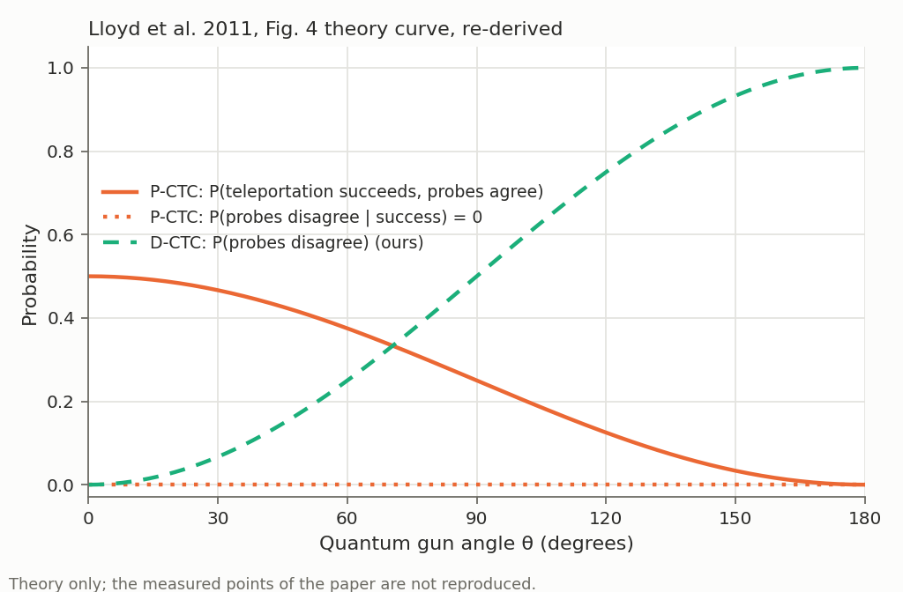

# Reproducing published numbers: Lloyd et al. 2011, Brun–Harrington–Wilde 2009

Created 2026-11-22 with AI assistance (Claude). No external review.

```text
python -B ctc/tests/test_literature.py   # 11 tests
python -B ctc/reproduce_literature.py    # writes output/literature.json and output/lloyd_fig4_theory.png
```

The circuit wiring was read from the figures in the arXiv PDFs of the two papers; the code is in [literature.py](literature.py). Items marked "derived here" are not in the papers.

## Sources

- **[L11]** S. Lloyd, L. Maccone, R. Garcia-Patron, V. Giovannetti, Y. Shikano, S. Pirandola, L. A. Rozema, A. Darabi, Y. Soudagar, L. K. Shalm, A. M. Steinberg, "Closed timelike curves via post-selection: theory and experimental demonstration", [arXiv:1005.2219v1](https://arxiv.org/abs/1005.2219); Phys. Rev. Lett. 106, 040403 (2011).
- **[L11-PRD]** S. Lloyd et al., "The quantum mechanics of time travel through post-selected teleportation", [arXiv:1007.2615v2](https://arxiv.org/abs/1007.2615); Phys. Rev. D 84, 025007 (2011). Eqs. (8)–(9) are used.
- **[BHW]** T. A. Brun, J. Harrington, M. M. Wilde, "Localized closed timelike curves can perfectly distinguish quantum states", [arXiv:0811.1209v2](https://arxiv.org/abs/0811.1209); Phys. Rev. Lett. 102, 210402 (2009).

## Reproduced results

| Claim in the paper | Where | Result here |
|---|---|---|
| The two-state circuit distinguishes \|0⟩ and \|−⟩ perfectly; the loop's consistent solution is unique, \|0⟩⟨0\| and \|1⟩⟨1\| respectively | [BHW] Fig. 1 | ✅ outcomes 0 and 1, unique fixed point |
| The four BB84 states are distinguished perfectly: \|00⟩→\|00⟩, \|+0⟩→\|10⟩, \|10⟩→\|01⟩, \|−0⟩→\|11⟩ | [BHW] Fig. 2, Eq. (3) | ✅ all four inputs give the claimed result with probability 1 |
| The BB84 consistent solution is unique and a computational basis state | [BHW] text | ✅ fixed-point space has dimension 1, the fixed point is \|ab⟩⟨ab\| |
| Grandfather paradox with a perfect gun (σx): the P-CTC projection amplitude is always zero | [L11] p. 3 | ✅ C = Tr_CTC U gives 0; postselection success is 0 |
| D-CTC's unique fixed point is (\|0⟩⟨0\| + \|1⟩⟨1\|)/2 and "with Deutsch's CTCs she always succeeds" | [L11] p. 2, Fig. 2 caption | ✅ unique fixed point; the two probes disagree with probability 1 |
| With an imperfect gun the probes never read 01 or 10 | [L11] p. 3, Fig. 4 | ✅ 0 under P-CTC for every θ < π |
| Fig. 4 theory curve: 0.5 at θ = 0, falling to 0 at θ = 180° | [L11] Fig. 4 | ✅ postselection success is cos²(θ/2)/2, 0.25 at θ = 90°. The closed form is derived here; the paper only plots the curve |
| Postselected teleportation equals CρC†/Tr with C = Tr_CTC U | [L11-PRD] Eqs. (8)–(9) | ✅ direct simulation of the teleportation circuit agrees with the C formula, including the success probability Tr[CρC†]/d² |
| Unproved-theorem paradox: the proof bit is completely random because it is maximally entangled with the bit leaving the CTC | [L11] Fig. 2b caption | ✅ output (\|00⟩ + \|11⟩)/√2; the proof bit's reduced state is I/2 |



## Additional results derived here

| Result | Meaning |
|---|---|
| Under D-CTC, Lloyd's gun makes the two probes disagree ("kill") with probability sin²(θ/2) | the opposite of P-CTC: under P-CTC the kill never happens; under D-CTC, the more accurate the gun, the more likely the kill |
| Under D-CTC the unproved-theorem circuit gives the classically correlated mixture (\|00⟩⟨00\| + \|11⟩⟨11\|)/2 | the statistics match P-CTC, but P-CTC gives entanglement and D-CTC only classical correlation; consistent with the bootstrap-paradox result in ctc/README.md |
| The BB84 circuit with a mixed input (half \|0⟩, half \|+⟩) does not output the average of the two outputs | D-CTC is nonlinear. This is the "linearity trap" raised by Bennett, Leung, Smith and Smolin (PRL 103, 170502, 2009; ref. [19] of [L11]); this project only demonstrates it and takes no side in the debate |

## Conventions and clarifications

1. **The gun:** [L11] writes U(θ) = e^{−iθσx}, expands it as cos(θ/2)𝟙 − i sin(θ/2)σx, and says θ = π flips the bit. For all three to agree it must be **e^{−iθσx/2}**, which is used here. Taken literally, e^{−iθσx} at θ = π is −𝟙 and the gun never fires.
2. **Lloyd's experimental circuit:** in Fig. 3a the probes are attached to the "forward" polarization qubit, which in the P-CTC description is the time-travelling qubit. Here the abstract circuit of Fig. 2a is used directly; the optics are not simulated.
3. **BB84 wiring:** the text says only "two SWAPs followed by four controlled unitaries". Fig. 2 shows: ψ is swapped with the first CTC qubit, the ancilla with the second CTC qubit, and each U_ab acts on the two CTC qubits, controlled by the value ab of the CR qubits. The SWAP inside U_00 and U_11 swaps the two CTC qubits; the first tensor factor acts on the first CTC qubit.
4. **Normalization of success probabilities:** Tr[CρC†]/d² is the success probability for teleportation through the maximally entangled state Σ\|ii⟩/√d. The `p_ctc_weight` column in `ctc/output/toy_results.csv` is Tr[CρC†] without the 1/d².

## Limitations

- Only theoretical predictions are reproduced, not the experimental data points of [L11]. The Fig. 4 data come from measurement; the paper attributes the deviation of the same-outcome curve from theory to a 1.1 ± 0.1° polarizer offset, and measures the different-outcome probability as 0.01 ± 0.04.
- The general N-state construction of [BHW] (Gram–Schmidt construction of the U_k) is not implemented; only N = 2 and N = 4 are.
- The papers were checked against their arXiv versions, not the journal versions.
