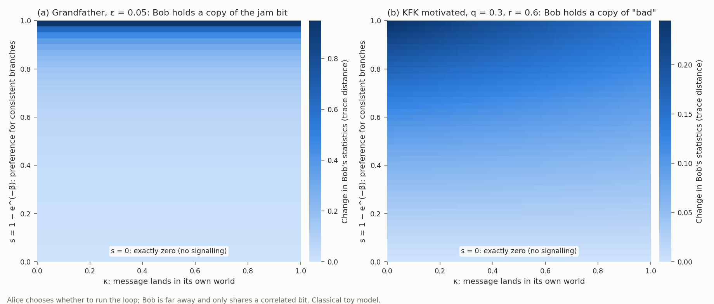

# No-signalling tests: can H2 coexist with relativity?

Created 2026-11-22 with AI assistance (Claude). The propositions and proofs were derived in this project; in spirit they are largely known (see the last section). No external review.

```text
python -B ctc/tests/test_signalling.py   # 11 tests
python -B ctc/run_signalling.py          # writes output/signalling.json and output/signalling_map.png
```

The code is in [signalling.py](signalling.py).

## Summary

> **In every rule studied here, "the loop reweights Alice's world" (H2) and "Alice can send a faster-than-light signal to a distant Bob" are the same thing.** The change in Bob's statistics equals the amount by which the correlated variable on Alice's side is reweighted.

So H2 as originally stated cannot coexist with relativity's no-signalling condition. Keeping H2 requires changing its form; possible directions are in the last sections.

## Test setup

- **Alice** owns the loop circuit and can freely decide whether to switch the loop on.
- **Bob** is far away. Before the loop runs, he shares a correlation with one of Alice's CR bits: classically, Bob holds a perfect copy of that bit; quantum mechanically, the two are in the entangled state √(1−p)|00⟩ + √p|11⟩.
- Adding Bob changes none of Alice's own results (tested).
- **Alice → Bob:** compare Bob's state when Alice switches the loop on and when she does not, using the trace distance. Anything nonzero means Alice can signal to Bob by her choice.
- **Bob → Alice:** before Alice's loop runs, Bob freely chooses to measure in the Z or X basis. Check whether Alice's output reveals Bob's choice.

## Results: Alice → Bob

The table gives the change in Bob's statistics (trace distance); 0 means no signalling.

| Scenario (bit Bob holds a copy of) | No loop | D-CTC | P-CTC | κ–β, β = 0 | κ–β, β > 0 |
|---|---|---|---|---|---|
| Grandfather paradox, ε = 0.05 ("fail" bit) | 0 | 0 | **0.95** | 0 | **> 0** (0.95 at β = ∞) |
| KFK motivated sender ("bad choice" bit) | 0 | 0 | **0.154** | 0 | **> 0** (0.245 at the typical-but-consistent corner) |
| KFK unconditional sender | 0 | 0 | 0 | 0 | 0 |
| Quantum interference, CZ (bit a) | 0 | 0 | **0.5** | n/a (phases) | n/a |
| Bootstrap paradox (record bit) | 0 | 0 | 0 | 0 | 0 |

The classical and quantum-entangled versions give identical numbers.



On the κ–β plane only the edge s = 0 (β = 0) is completely signal-free; everywhere else signalling is possible.

The bootstrap paradox shows no signalling here only because the record bit starts fixed at 0, so Bob has no real correlation with it. With the record bit made 50/50 and entangled with Bob, P-CTC changes Bob's state by 0.5 (test `test_bootstrap_signals_once_the_record_is_entangled`).

## Results: Bob → Alice

Using the Brun–Harrington–Wilde BB84 circuit, with Alice's input bit maximally entangled with Bob:

| Rule and how it is applied | Alice's result after Bob measures Z | Alice's result after Bob measures X |
|---|---|---|
| P-CTC on the global state | each of four outcomes 1/4 | each of four outcomes 1/4 |
| D-CTC on Alice's reduced state | each of four outcomes 1/4 | each of four outcomes 1/4 |
| **D-CTC applied separately for each of Bob's outcomes** | **first bit always 0** | **first bit always 1** |

If D-CTC is applied branch by branch, Bob can signal to Alice **perfectly** by his choice of basis. Only by insisting that D-CTC acts on the reduced density matrix, i.e. by not treating Alice's mixed state as "really in one branch, we just don't know which", is signalling avoided. This is the concrete no-signalling consequence of the "linearity trap" of Bennett, Leung, Smith and Smolin (2009).

## Three propositions

**Proposition 1 (classical κ–β model).** Let R(a) be the total weight of Alice's local world a after the loop divided by its prior probability. For every correlation Bob might share with Alice, Bob's statistics are unchanged if and only if R(a) is the same for all of Alice's local worlds. At β = 0, R(a) = 1, so there is never any signalling.

*Proof sketch:* the message dynamics see only Alice's variables, so each branch's weight ratio depends only on a. Bob's marginal is P(b) = Σ_a P0(a, b) R(a) / Σ_a P0(a) R(a). This equals P0(b) for all P0 if and only if R is constant on the support of P0.

**Proposition 2 (quantum P-CTC).** Let C = Tr_loop U. P-CTC cannot signal for any shared state of Alice and Bob if and only if C†C is proportional to the identity, i.e. C is proportional to a unitary. P-CTC is then an ordinary local unitary on Alice's side with no reweighting at all.

*Proof sketch:* Bob's state is Tr_A[(C†C ⊗ 𝟙) ρ_AB] / Tr[…]. If Bob is maximally entangled with Alice's whole CR system, Bob's state is proportional to (C†C)^T, which equals his original 𝟙/d if and only if C†C ∝ 𝟙. Test `test_bob_state_is_transpose_of_cdagc` confirms the formula.

**Proposition 3 (D-CTC).** Applied to the reduced state, D-CTC cannot signal in either direction: the loop acts only on Alice's side and preserves the trace. Applied branch by branch, Bob can signal to Alice; the BB84 circuit is an example of perfect signalling.

## What this means for H2

Together:

- Every rule that reweights Alice's world (P-CTC, every κ–β rule with β > 0) lets Alice signal to Bob, by exactly the amount of the reweighting.
- Every rule that cannot signal (D-CTC, β = 0) does not reweight Alice's world.

In these models H2 and no-signalling exclude each other. Possible ways out, as listed when this was written:

1. **Restrict H2:** claim only that the loop reweights variables with no prior correlation with anything outside, for example a quantum random number freshly generated in the lab. The difficulty is that one cannot guarantee a variable is uncorrelated with everything far away. (Follow-up: past-preserving selection implements this route, with purity as a local criterion; see [PAST_PRESERVING.md](PAST_PRESERVING.md). It became the chosen way out, H2′, proved in [THEOREMS.md](THEOREMS.md).)
2. **Global rule:** let the consistency condition include Bob's side as well, so the rule is no longer local to Alice. The process-matrix framework goes this way, but it is linear and has no reweighting of its own.
3. **Accept limited signalling:** for example only into the causal future of the loop region. In this setup Bob is spacelike-separated from Alice, so this would still violate relativity.
4. **Question Alice's free choice:** if Alice's decision to switch the loop on is itself constrained by consistency, the signalling argument fails. This is close to superdeterminism and has a high philosophical price.
5. **Rewrite H2 as a D-CTC-like effect:** the loop changes only the content of the message, not the probabilities of the world. Compatible with relativity, but it gives up H2's core claim of changing future statistics.

## Relation to the literature

- Gisin (1990) showed that generic deterministic nonlinear quantum mechanics allows faster-than-light signalling. P-CTC's renormalization is nonlinear, so the result is expected.
- Ralph (2011) argued that P-CTC lets signals reach times before the loop was created, and Lloyd et al. replied. That is a different signalling question; this project has not reproduced the construction.
- **Known results:** that P-CTC allows superluminal signalling is argued in Bub & Stairs 2014 (Section III). That D-CTC's predictions depend on how the rule is applied is discussed by Cavalcanti, Menicucci & Pienaar 2012 (the preparation problem) and Bennett et al. 2009 (the linearity trap); Bub & Stairs 2014 (Section II) frame the related issue as frame dependence of D-CTC. The substance of Proposition 2 follows from Araújo, Guérin & Baumeler 2017, who prove that the P-CTC map is linear if and only if the postselection probability is constant (which is exactly the process-matrix case); they do not discuss signalling themselves, and the C†C form is the direct single-party consequence. See [NOVELTY_CHECK.md](NOVELTY_CHECK.md).
- What may be this project's own contribution is the **organization**: showing within a continuous family of rules that reweighting and signalling are the same thing, and connecting this directly to claims that a loop changes the future.
- **The fourth rule, T-CTC (Allen 2014), fits the same pattern:** it reweights, and it signals (grandfather paradox 0.086, quantum interference 0.25), with the same criterion C†C ∝ 𝟙. See [T_CTC.md](T_CTC.md).

## Limitations

- The classical κ–β model covers only permutation circuits. A quantum κ–β model has not been implemented.
- Only the choice "Alice switches the loop on or off" was tested. Other choices (for example changing the gun's angle) give similar results but are not listed one by one.
- The spacetime structure of the loop region itself is not modelled, for example whether Bob is in the loop's causal future.
