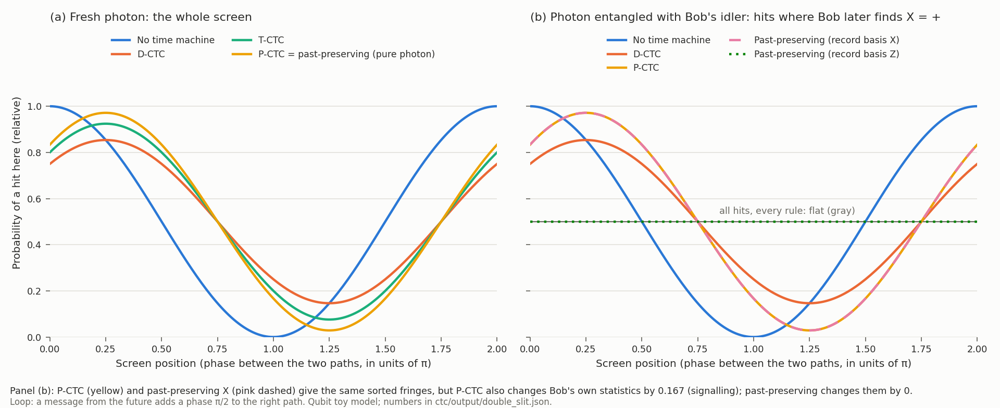

# Past-preserving selection, and a double slit with a time loop

Created 2026-11-22 with AI assistance (Claude). The rule is a candidate proposed in this project. No external review. Novelty: partly known, see point 4 under "Open problems".

**Naming.** The rule is abbreviated **PPS** in the documentation, to avoid a clash with the complexity class PP. The code keeps the name `past_preserving`.

```text
python -B ctc/tests/test_past_preserving.py   # 9 tests
python -B ctc/run_double_slit.py              # writes output/double_slit.json and output/double_slit.png
```

The code is in [past_preserving.py](past_preserving.py) and [double_slit.py](double_slit.py).

## Summary

1. **PPS mathematically cannot signal**, in either direction, whatever state Alice shares with anyone.
2. **It reproduces the original hypothesis:** the grandfather paradox's probabilities do not change at all; in KFK the probability of the "bad inclination" is unchanged, but the "bad outcome" drops from 0.30 to 0.21.
3. **In the double slit it connects way out 1 and way out 2** (of [NO_SIGNALLING.md](NO_SIGNALLING.md)): when the photon is entangled with Bob's idler, the loop's effect appears only in fringes sorted by Bob's result, while the overall screen and Bob's own statistics are unchanged. This is the structure of a quantum eraser.
4. **One open problem:** one must specify which basis counts as the "recorded past". In the entangled double slit, two equally reasonable choices give different experimental predictions.

## The rule

First fix a "record basis" {|k⟩} for Alice's input: the facts that have already happened and been recorded. Then:

- World k keeps probability ⟨k|ρ|k⟩. **Past probabilities may not change.**
- Inside world k apply P-CTC's consistency selection: |k⟩ → C|k⟩/‖C|k⟩‖, with C = Tr_loop U.
- If world k has no consistent history at all (C|k⟩ = 0), fall back to D-CTC: the loop message becomes mixed.

As operators: ρ → Σ_k K_k ρ K_k† with K_k = C|k⟩⟨k|/‖C|k⟩‖ and Σ_k K_k†K_k = 𝟙. So it is a **linear, trace-preserving, ordinary quantum channel**:

- Alice → Bob: Bob's state cannot change (tested on 10 random unitaries with random entangled states).
- Bob → Alice: whatever basis Bob measures in beforehand, Alice's output is the same (same tests).

**In other words: first fix the past in the record basis, then apply consistency selection inside each past world.** It cannot signal precisely because it does not reweight the past.

## Results: the original scenarios

| Scenario | Observable | No loop | D-CTC | P-CTC | **PPS** |
|---|---|---|---|---|---|
| Grandfather paradox, ε = 0.05 | P(gun jams) | 0.05 | 0.05 | 1 | **0.05** (the gun works; in the paradox world the message becomes mixed) |
| KFK motivated sender | P(bad inclination) | 0.30 | 0.30 | 0.255 | **0.30** |
| KFK motivated sender | P(bad outcome) | 0.30 | 0.254 | 0.146 | **0.21** = q(1 − r/2) |
| KFK unconditional sender | P(bad outcome) | 0.30 | 0.12 | 0.12 | **0.12** |
| Bootstrap paradox | recorded ⟨X⟩ | 0 | 0 | 1 | **1** |
| Signalling to a distant Bob | all scenarios | 0 | 0 | up to 0.95 | **0** |

This is exactly "the grandfather paradox is unaffected; what changes is the future": past probabilities do not move, future outcomes do.

Where the 0.21 in KFK comes from: the world "bad inclination and the warning works" has no consistent history (if the warning works, no warning is sent), so it falls back to D-CTC and the bad outcome has probability 1/2. The world "bad inclination but the warning does not work" has exactly one consistent history: the warning arrives, and the bad choice is made anyway.

## Results: a double slit with a time loop

Model: path qubit |0⟩ = left slit, |1⟩ = right slit. The screen position is represented by the phase θ between the two paths. The loop is a bit from the future that, when 1, adds a phase φ to the right path. Without a time machine there is no message and nothing happens.



### (a) A fresh photon (pure state, correlated with nothing)

φ = π/2:

| Rule | P(right slit) | Fringe visibility | Fringe shift |
|---|---|---|---|
| No time machine | 0.5 | 1 | 0 |
| D-CTC | 0.5 | 0.707 | π/4 |
| T-CTC | 0.4 | 0.849 | π/4 |
| P-CTC = PPS | 1/3 | 0.943 | π/4 |

For a pure photon the natural record basis contains the state itself, so PPS equals P-CTC: the fringes shift and the right-slit probability drops. At φ = π, P-CTC is equivalent to closing the right slit.

This causes no signalling, because a pure state guarantees no correlation with anything else. It also gives way out 1 of NO_SIGNALLING.md (reweight only variables uncorrelated with the outside) a local criterion: **purity**.

### (b) The photon entangled with Bob's idler (delayed-choice quantum eraser)

φ = π/2:

| Rule | Fringes on the whole screen | Fringes sorted by Bob's X = + | Change in Bob's own statistics |
|---|---|---|---|
| No time machine | none | visibility 1, no shift | 0 |
| D-CTC | none | visibility 0.707, shift π/4 | 0 |
| T-CTC | none | visibility 0.849, shift π/4 | 0.1 (signalling) |
| P-CTC | none | visibility 0.943, shift π/4 | 0.167 (signalling) |
| **PPS, record basis X** | none | **visibility 0.943, shift π/4** | **0** |
| PPS, record basis Z | none | none (the loop acts as a path measurement) | 0 |

PPS with record basis X makes the loop's effect as strong as P-CTC's, but the effect hides only in data sorted by Bob's result; the whole screen and Bob's own statistics are unchanged, so there is no signalling. The rule of way out 1 produces exactly the observable effect of way out 2.

## Open problems

1. **Who fixes the record basis?** In (b) the photon's reduced state is 𝟙/2, so Z and X are both eigenbases, yet they predict completely different things: X gives shifted fringes, Z removes them. This is the "preparation problem" of nonlinear theories (Cavalcanti–Menicucci–Pienaar 2012) appearing with concrete numbers. A possible answer is "the basis irreversibly recorded by the environment", i.e. decoherence, but before Bob measures, the path has not yet been recorded by anything. This is the key question for this way out. (Follow-up: an attempt to let decoherence fix the basis is in [DECOHERENCE.md](DECOHERENCE.md).) **Answer (2026-11-24): Theorem 4 in [THEOREMS.md](THEOREMS.md).** The record basis is the pointer basis of the interaction that correlated the path with the idler. A CNOT reads the path in Z, so the eraser's record basis is Z: the loop acts as a path measurement and the Bob-sorted fringes vanish. The X-basis column above is a variant that Theorem 4 does not support.
2. **Bob's choice cannot be what fixes the basis.** If the record basis followed Bob's later measurement, the rule would be applied branch by branch, and Bob could signal to Alice (shown in NO_SIGNALLING.md).
3. **Falling back to D-CTC in paradox worlds is a hybrid rule.** It makes PPS equal D-CTC in paradox worlds, so the rule is partly P-CTC and partly D-CTC, and the seam needs a better justification.
4. **Novelty: partly known (updated 2026-11-24).** The rule inside each world is Hartle 1994, Eq. (5.6): the conditional probability when the initial state is decohered by a persistent record. Hartle's framework reweights the recorded past; PPS does not. That is the only difference. Hartle 1994 does not propose the causal version, but later work citing it has not been checked. Details in [NOVELTY_CHECK.md](NOVELTY_CHECK.md), third round. The classical part (each input world self-consistent on its own) is also close in spirit to Baumeler–Wolf process functions.

## What this means for H2

With PPS, H2 can be restated as:

> **H2′:** the loop does not change the probability of any recorded past. Its observable effect is to redistribute future outcomes inside each recorded past world. For systems correlated with the outside, this effect appears only in conditional correlations (for example sorted by the other party's measurement result), so it cannot signal.

This version is compatible with relativity and keeps the core idea of "changing future statistics": the KFK bad outcome really does drop from 0.30 to 0.21. The price is that one must say what fixes the record basis.
