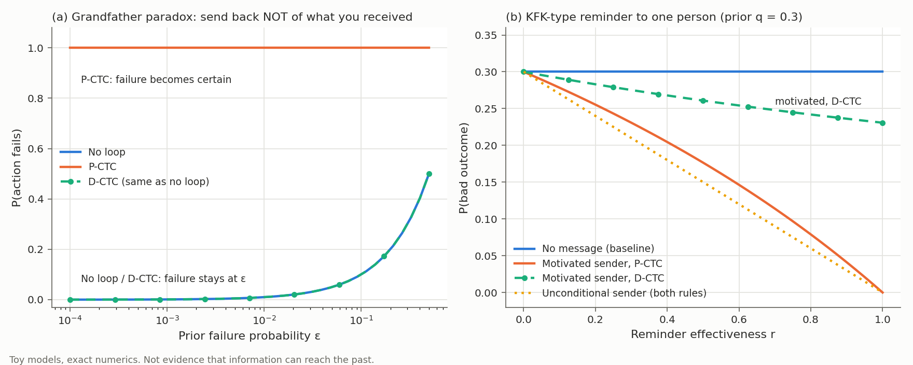

# ctc/: models, theorems and experiments

Created 2026-11-22, last updated 2026-11-24, with AI assistance (Claude). No external review.

The models here are small exact numerical calculations. They describe how the world would behave **if** time loops existed; they are **not** evidence that information can reach the past. The IBM quantum-computer experiments ([hardware/](hardware/README.md), [born_rule/](born_rule/README.md)) implement loop rules by postselection or test the loop model's predictions against ordinary quantum mechanics.

## Running the tests

```text
python -B ctc/tests/test_models.py              # 10  rules vs hand-derived results
python -B ctc/tests/test_literature.py          # 11  Lloyd 2011 and Brun–Harrington–Wilde 2009
python -B ctc/tests/test_branches.py            #  8  κ–β branch model
python -B ctc/tests/test_quantum_effects.py     #  7  interference between consistent histories
python -B ctc/tests/test_signalling.py          # 11  no-signalling
python -B ctc/tests/test_t_ctc.py               # 12  T-CTC (Allen 2014)
python -B ctc/tests/test_past_preserving.py     #  9  past-preserving selection, double slit
python -B ctc/tests/test_decoherence.py         #  6  decoherence-defined record basis
python -B ctc/tests/test_theorems.py            # 11  every theorem in THEOREMS.md on random circuits
python -B ctc/tests/test_records.py             # 11  Theorem 4: record basis from the interaction, no-signalling
python -B ctc/tests/test_readouts.py            # 10  Theorem 4a-4c: incompatible, coarse and weak readouts
python -B ctc/tests/test_computational_power.py #  5  PPS equals P-CTC on definite inputs
python -B ctc/tests/test_hartle.py              #  1  PPS vs Hartle 1994, Eqs. (5.5)–(5.6)
python -B ctc/tests/test_hardware.py            #  8  hardware circuits and estimators (3 need qiskit)
python -B ctc/tests/test_born_rule.py           #  6  loop model vs Born-rule tests
python -B ctc/tests/test_born_direct.py         #  8  direct pure-vs-recorded test design
python -B ctc/tests/test_blockchain.py          # 23  blockchain lottery protocol (offline)
python -B ctc/tests/test_invitation.py          # 43  invitation to future senders: reply checks, block scans, mock run with attackers, rule predictions
python -B ctc/tests/test_timeless.py            # 16  loop rules in a timeless (Page–Wootters) universe, seam at the loop event
python -B ctc/tests/test_clocks.py              #  8  local clocks (frames) and a superposed clock
python -B ctc/tests/test_operation_linearity.py  #  5  is PPS linear in the loop's own operation? (process matrices)
python -B ctc/tests/test_decoherent_histories.py # 5  Theorem 4's records vs Gell-Mann-Hartle strong decoherence
python -B ctc/tests/test_wormhole.py            # 10  time dilation with light clocks, a wormhole time machine, the loop on it
python -B ctc/tests/test_lightcone.py           # 26  light cones: Theorem 5 on random 1-3D spacetimes, a black hole, the backward-signal example
```

270 tests in total (2026-11-25). Without qiskit, 3 gate-level hardware tests are skipped; without `opentimestamps-client`, 1 blockchain proof-parsing test is skipped.

## Regenerating results

```text
python -B ctc/run_toy.py                # output/ CSV, JSON and figure for the three toy scenarios
python -B ctc/reproduce_literature.py   # literature reproduction JSON and figure
python -B ctc/run_branches.py           # κ–β plane CSV and figure
python -B ctc/run_signalling.py         # no-signalling JSON and map
python -B ctc/run_t_ctc.py              # four rules side by side; signalling along the P-CTC ↔ T-CTC line
python -B ctc/run_double_slit.py        # double slit and quantum eraser
python -B ctc/run_decoherence.py        # record-strength sweep
python -B ctc/hardware/run_local.py     # full hardware analysis on an ideal simulator (needs qiskit)
python -B ctc/born_rule/compare.py      # Born-rule bounds figure
python -B ctc/conjectures/evaluate.py   # conjecture lottery verdicts and score
```

Requires NumPy; figures need matplotlib; hardware code needs qiskit (and qiskit-ibm-runtime for real devices). Run with Python 3.11.0, NumPy 2.3.2, matplotlib 3.10.0; the tests also pass on Python 3.13 with NumPy 2.5.

## Documents

| Document | Content |
|---|---|
| [THEOREMS.md](THEOREMS.md) | H1′–H3′ under past-preserving selection, and Theorem 4 (where the record basis comes from): statements, proofs, checks |
| [PAST_PRESERVING.md](PAST_PRESERVING.md) | the PPS rule; a double slit and quantum eraser with a time loop |
| [DECOHERENCE.md](DECOHERENCE.md) | letting decoherence fix the record basis |
| [timeless/README.md](timeless/README.md) | PPS in a timeless (Page–Wootters) universe: the past must be defined by influence, not clock order |
| [NO_SIGNALLING.md](NO_SIGNALLING.md) | reweighting the world equals faster-than-light signalling |
| [QUANTUM_EFFECTS.md](QUANTUM_EFFECTS.md) | interference between consistent histories |
| [T_CTC.md](T_CTC.md) | Allen's T-CTC as a fourth rule |
| [BRANCHES.md](BRANCHES.md) | the classical κ–β model with D-CTC and P-CTC as corners |
| [LITERATURE_REPRODUCTION.md](LITERATURE_REPRODUCTION.md) | Lloyd 2011 and Brun–Harrington–Wilde 2009 reproduced |
| [NOVELTY_CHECK.md](NOVELTY_CHECK.md) | what is already known, including Hartle 1994 |
| [hardware/README.md](hardware/README.md) | IBM runs of the loop rules (postselected teleportation) |
| [born_rule/README.md](born_rule/README.md) | microscopic loops vs Born-rule tests; direct test on IBM hardware |
| [conjectures/README.md](conjectures/README.md) | conjecture lottery: credences fixed before exhaustive checks |
| [blockchain/README.md](blockchain/README.md) | Bitcoin-anchored self-consistency lottery (designed, not run) |
| [invitation/README.md](invitation/README.md) | invitation to future senders: reply a block hash before the block exists (designed, not published) |

## Code

| File | Content |
|---|---|
| `models.py` | four rules: no loop, P-CTC (Lloyd et al. 2011), D-CTC (Deutsch 1991), T-CTC (Allen 2014); plus a direct simulation of postselected teleportation |
| `circuits.py` | grandfather paradox, KFK-type warning, bootstrap paradox; two quantum-only circuits (controlled-phase interference, phase-only loop) |
| `literature.py` | circuits read from the papers' figures: Lloyd 2011 Fig. 2, Brun–Harrington–Wilde 2009 Figs. 1–2 |
| `branches.py` | the classical weighted-branch model: κ (where the message comes from) and β (selection strength) |
| `signalling.py` | adds a distant Bob and checks signalling in both directions |
| `past_preserving.py` | past-preserving selection |
| `records.py` | the record basis read off an interaction (pointer basis), for Theorem 4 |
| `double_slit.py` | double slit with a time loop, including the quantum-eraser version |
| `decoherence.py` | environment partly recording the path; decoherence-defined PPS |
| `run_*.py`, `reproduce_literature.py` | parameter sweeps and figures |
| `hardware/` | IBM experiments: circuits, preregistration, analysis, raw data of three runs |
| `born_rule/` | loop model, comparison with published Sorkin bounds, direct test and control on IBM hardware |
| `conjectures/` | conjecture pool, credences, exhaustive evaluator |
| `blockchain/` | protocol, Bitcoin header checks, OpenTimestamps and Internet Archive helpers |
| `invitation/` | reply formats, raw-transaction and merkle-proof checks, validity rules, toy model of the rule predictions |
| `timeless/` | Page–Wootters history states, the loop as a constraint on a static state, three definitions of "the past" |
| `tests/` | all tests listed above |
| `output/` | generated tables and figures (`toy_results.csv` holds every number in the toy figure) |

When D-CTC has several fixed points, the code picks the Cesàro limit starting from the maximally mixed state. In these scenarios that is the maximum-entropy fixed point, but this is not guaranteed in general.

## Toy results



### (a) Grandfather paradox
A bit is received and its opposite is meant to be sent back, but the action fails with probability ε.

| Rule | P(action fails) | How consistency is reached |
|---|---|---|
| No loop | ε | no consistency needed |
| P-CTC | **1**, however small ε is | only the "action fails" history is consistent; for ε = 0 there is no consistent history and the rule is undefined |
| D-CTC | ε | the message in the loop becomes a 50/50 mixture; future statistics are unchanged |

**Meaning for the hypotheses:** H2, "the effect appears in the future", holds strongly under P-CTC and not at all under D-CTC in this scenario. The two time pictures are not just philosophy: they make different predictions.

### (b) KFK-type warning
Without a warning, a person makes a bad choice with probability q = 0.3. A warning works with probability r.

| Sender | Rule | P(bad outcome) |
|---|---|---|
| No message (baseline) | — | q |
| Unconditional (always warns) | P-CTC and D-CTC agree | q(1 − r) |
| Motivated (warns only if the bad outcome happened) | P-CTC | q(1 − r) / (1 − qr) |
| Motivated | D-CTC | q / (1 + qr) |

Observations:

1. **Unconditional sender**, i.e. "I only came to warn you": both rules agree, there is no paradox and no reweighting. From the receiver's side this is exactly an ordinary message, so **from the receiver's side alone one cannot tell whether a message came from the future**.
2. **Motivated sender**, a kind of grandfather paradox: if the warning works there is no reason to send it.
   - Under P-CTC, at r = 1 the bad outcome has probability 0. Not because the warning worked: the only remaining consistent history is "no warning arrives, and the person happens to choose well". The future did change, but consistency selection changed it, not the message.
   - Under D-CTC the effect is much milder: 0.3 / 1.3 ≈ 0.23 at r = 1.
3. Under P-CTC, q = 1 and r = 1 leave no consistent history: a true paradox.

### (c) Bootstrap paradox
A message with no origin: it is recorded and sent back unchanged.

| Rule | P(record = 1) | ⟨X⟩ of the record |
|---|---|---|
| No loop (external input an unknown bit) | 0.5 | 0 |
| P-CTC | 0.5 | **1** (coherent superposition) |
| D-CTC | 0.5 | 0 (mixture) |

In the computational basis the three rules agree, but in the X basis P-CTC and D-CTC differ, giving an observable that separates the rules. The result also depends on the baseline: with external input |+⟩, the no-loop case gives ⟨X⟩ = 1 too.

## Limitations

- All scenarios are toy circuits of one to six qubits, mostly classical reversible circuits with classical inputs.
- P-CTC and D-CTC are known models, and result (a) agrees conceptually with the discussion in Lloyd et al. 2011. Specific claims of Lloyd 2011 and Brun–Harrington–Wilde 2009 are reproduced one by one in [LITERATURE_REPRODUCTION.md](LITERATURE_REPRODUCTION.md).
- Simulating P-CTC by postselection on an ordinary quantum computer gives the same numbers, but that is a simulation, not evidence.
- The `p_ctc_weight` column is the unnormalized Tr[CρC†]. Dividing by d² (d the loop dimension) gives the postselection success probability for a teleportation implementation, available as `models.p_ctc_success_probability`.
