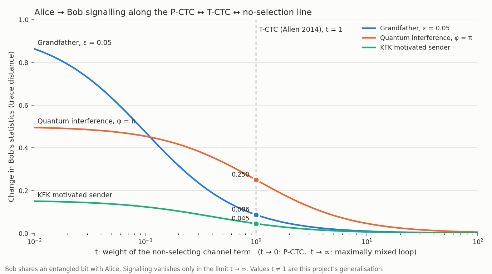

# A fourth rule: T-CTC (Allen 2014)

Created 2026-11-22 with AI assistance (Claude). No external review.

```text
python -B ctc/tests/test_t_ctc.py   # 12 tests
python -B ctc/run_t_ctc.py          # writes output/t_ctc.json and output/t_ctc_signalling.png
```

The code is `t_ctc` in [models.py](models.py).

## What T-CTC is

J.-M. A. Allen, "Treating Time Travel Quantum Mechanically", Phys. Rev. A 90, 042107 (2014), [arXiv:1401.4933](https://arxiv.org/abs/1401.4933).

It averages over all pure loop states |φ⟩, weighting each by the transition amplitude for the loop to start in |φ⟩ and return to |φ⟩ (Allen Eq. 24). The integral evaluates to (Allen Eq. 33)

```text
ρ_out ∝ C ρ C† + d · Tr_loop[ U (ρ ⊗ 𝟙/d) U† ]        C = Tr_loop U,  d = loop dimension
```

The first term is P-CTC's consistency selection; the second is the ordinary channel obtained by replacing the loop with a completely random message. In Allen's own words, T-CTC is a weighted mixture of P-CTC and an ordinary channel.

**Generalization in this project:** multiply the second term by t. t = 0 is P-CTC, t = 1 is Allen's T-CTC, t → ∞ is "fully random loop". t ≠ 1 is not Allen's proposal, but Allen states that transition-probability theories are a class of theories with no unique natural integration measure, so this generalization probably fits within his framework.

## Independent checks (all pass)

| Check | Method |
|---|---|
| Closed form Eq. 33 equals integral Eq. 24 | direct average over the 6 Pauli eigenstates (a 3-design, so for quadratic expressions it equals the Haar integral exactly), including random unitaries |
| Allen Eq. 35 (unproved-theorem circuit) | ½\|00⟩⟨00\| + ¼\|00⟩⟨11\| + ¼\|11⟩⟨00\| + ½\|11⟩⟨11\|, matches term by term |
| Allen Eq. 38 (weight of the channel term) | λ = d / (d + ‖Cψ‖²) ≥ 1/(d+1) |
| Allen §IV E.1 (product unitaries) | for U = V ⊗ W the output is VρV† |
| Allen Eq. 40 (bound on distinguishing non-orthogonal states) | 20 random cases all within the bound |
| Limits | t = 0 equals P-CTC; t = ∞ equals a fully random loop |

## Results: four rules side by side

| Scenario | Observable | No loop | D-CTC | **T-CTC** | P-CTC |
|---|---|---|---|---|---|
| Grandfather paradox, ε = 0.05 | P(gun jams) | 0.05 | 0.05 | **0.136** | 1 |
| KFK motivated sender | P(bad outcome) | 0.30 | 0.254 | **0.191** | 0.146 |
| KFK unconditional sender | P(bad outcome) | 0.30 | 0.12 | **0.18** | 0.12 |
| Quantum interference, φ = π | P(a = 1) | 0.5 | 0.5 | **0.25** | 0 |
| Bootstrap paradox | recorded ⟨X⟩ | 0 | 0 | **0.5** | 1 |
| Lloyd's gun, θ = π/2 | P(two probes agree) | 0.5 | 0.5 | **0.667** | 1 |
| BB84, input \|0⟩ | P(correct label) | 0.25 | 1 | **1/3** | 0.5 |

Grandfather paradox closed form: P(jam) = ε(2 + t)/(t + 2ε); for T-CTC, 3ε/(1 + 2ε).

Observations:

1. **T-CTC mostly lies between P-CTC and D-CTC**, with two exceptions: the KFK unconditional sender and BB84. The other end of the t line is "fully random loop", not D-CTC; the two coincide only for circuits whose loop map preserves the maximally mixed state (such as the grandfather paradox).
2. **A perfect gun (ε = 0) has no paradox under T-CTC:** the gun works and the loop message becomes random. P-CTC is undefined here.
3. **New finding: under T-CTC the KFK unconditional sender differs from D-CTC and P-CTC.** The bad outcome is 0.18, not q(1 − r) = 0.12. The channel term replaces the loop message with a random bit, so part of the time the receiver gets noise instead of the warning. It still does not reweight the world (no signalling), but the statement "an unconditional message is the same under every rule" must be corrected: it holds for D-CTC and P-CTC; under T-CTC it behaves like an ordinary message that is **only partly delivered**.
4. BB84: T-CTC cannot distinguish perfectly, as Allen claims.

## Results: no-signalling

| Scenario (Bob shares entanglement) | D-CTC | **T-CTC** | P-CTC |
|---|---|---|---|
| Grandfather paradox | 0 | **0.086** | 0.95 |
| KFK motivated sender | 0 | **0.045** | 0.154 |
| KFK unconditional sender | 0 | 0 | 0 |
| Quantum interference | 0 | **0.25** | 0.5 |
| Bootstrap paradox | 0 | 0 | 0 |



- **T-CTC also lets Alice signal to Bob.** This agrees with Allen §IV E.5: T-CTC's nonlinearity makes an "entanglement detector" possible, as for D-CTC and P-CTC.
- **Same criterion as P-CTC:** when Bob is maximally entangled with Alice's whole CR system, Bob's state is proportional to (C†C)^T + t·d·𝟙. So for every finite t, "no signalling ⇔ C†C ∝ 𝟙".
- Along the t line the signalling decreases with t and **is zero only as t → ∞, where the world is no longer reweighted.** This matches the classical κ–β plane: any amount of consistency selection allows signalling.
- **Bob → Alice:** T-CTC applied to the global state cannot signal. Applied branch by branch, Bob measuring Z gives Alice P(jam) = ε, and Bob measuring X gives 3ε/(1 + 2ε), so Bob can signal. Same as D-CTC.

## What this means for novelty

This is the closest prior work to the κ–β model found so far:

- Allen 2014 already writes T-CTC as a weighted mixture of P-CTC and an ordinary channel, and says transition-probability theories form a class.
- But Allen gives **one point** (t = 1, weight fixed by the Haar measure), not a continuous family, and does not connect it to D-CTC.
- The κ–β model is a classical two-parameter plane whose corners are D-CTC and P-CTC. The t line is a quantum one-parameter line from P-CTC to a fully random loop. Both interpolate in selection strength, so any paper on the κ–β model must cite Allen 2014 and explain the difference.

Details in [NOVELTY_CHECK.md](NOVELTY_CHECK.md).

## Limitations

- t ≠ 1 is this project's generalization, a plain interpolation without physical derivation.
- The κ–β model and the t line are not yet in one framework: for classical permutation circuits with diagonal inputs, T-CTC's P-CTC term carries coherent cross terms, so T-CTC is in general not a point of the κ–β plane.
- The last ~19,000 characters of Allen's paper (end of Section V and references) were not read in the original.
