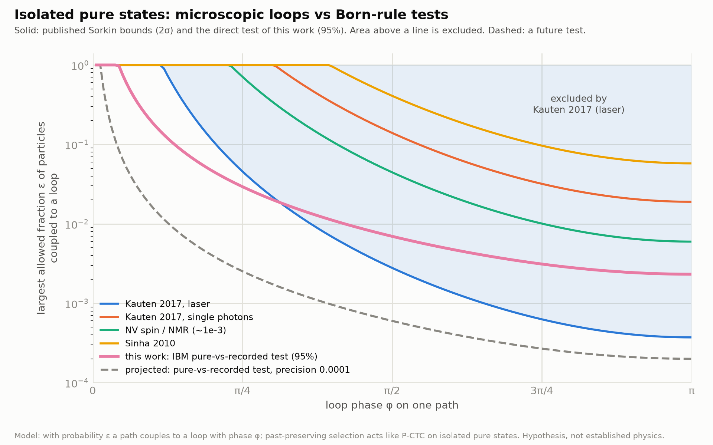

# 孤立純態的干涉：把預測量化，跟現有數據比對

建立日期：2026-11-23，撰寫時使用 AI 輔助（Claude）。沒有外部審查。

```text
python -B ctc/tests/test_born_rule.py    # 6 項檢查，含跟 past_preserving.py 的獨立交叉驗證
python -B ctc/born_rule/compare.py       # 產生 results.json 和 ../output/born_rule_bounds.png
```



## 最新結果：在 IBM 上做的直接測試（2026-11-23）

**沒有發現迴圈效應。** 95% 上限 |S| < 1.16×10⁻³，對 Z 基底耦合的模型：
- 每個粒子都受影響（ε = 1）時，迴圈相位必須小於 **0.136 弧度**（原本現有數據只限制到 0.37 弧度）。
- 在 φ = 0.14 到 0.98 弧度之間，這是目前最強的限制（圖中粉紅線）；更大的 φ 仍以 Kauten 2017 最強。

過程中出現過一次假警報，完整記錄如下：

| 步驟 | 結果 |
|---|---|
| 1. 直接測試（job `dc1k4l5hdvas73bkumqg`，預先登錄 `7a44cf36…`） | S = +0.0161 ± 0.0016，z = 10.3，24 對全部同方向：依判準為「異常」 |
| 2. 排查 | 發現設計漏洞：IBM 把 ±π/2 編譯成**同一個物理脈衝**（`sx`），正負號只是虛擬的相位座標變換，所以「相干性變成機率」的硬體誤差（例如 CNOT 脈衝串擾）沒有被抵消。約 2° 的串擾旋轉就能產生 0.017 的假訊號（[test_born_direct.py](../tests/test_born_direct.py) 的模擬） |
| 3. 預先登錄的對照（job `dc1k84ts2omc738anop0`，預先登錄 `3a2a3a38…`） | 改用真正翻轉物理相干性的脈衝（`sx` 對比 `x`+`sx`）：**S = −0.00014 ± 0.00052，z = −0.27**；被分離出來的奇數部分 O = +0.0150 ± 0.0018，24 對全部為正。完全符合串擾的預測，不符合迴圈模型的預測 |
| 結論 | 依判準，第一次的異常歸因於未抵消的相干性誤差。對照實驗的 S 是有效的測量，用來設定上面的上限 |

程式：[direct_test.py](direct_test.py)（第一版）、[physical_control.py](physical_control.py)（對照，也是目前有效的設計）。資料在 [data/](data/)。

**這次學到的：** 在量子電腦上，閘的「正負號」常常只是軟體上的座標變換，不是物理上的翻轉。任何依賴對稱性抵消誤差的設計，都必須檢查實際執行的脈衝。

## 結論先講（文獻比對）

1. **大的迴圈耦合已經被排除。** 如果迴圈讓某條路徑多出 φ = π/2 的相位，現有最好的三狹縫實驗（Kauten 等人 2017，雷射光）要求受影響的粒子比例 ε **小於 0.28%**；φ 接近 π 時小於 0.04%。
2. **小的迴圈耦合完全沒被檢驗過。** φ 小於約 0.37 弧度時，即使**每一個**粒子都受影響（ε = 1），現有數據也排除不了。
3. **原因是現有實驗量錯了東西。** 這些實驗量的是三階干涉（Sorkin 參數 κ）；在這個模型裡，κ 只跟 φ⁴ 成正比（κ ≈ 0.0035 ε φ⁴），而真正最大的效應是**二階**的：雙路徑疊加態的機率直接偏移 ε φ²/16。
4. **所以最該做的是一個還沒人做過的直接測試：** 同一個疊加態，一組不記錄直接測量，一組先跟輔助位元糾纏（記錄）再測量，比較兩組的機率。一般量子力學預測完全相同；這個模型預測不記錄的那組會偏移。精度 10⁻³ 的這種測試，在小 φ 的區域會比所有現有實驗強得多（圖中虛線）。

**這是限制，不是支持。** 一般量子力學預測所有偏差都是零，現有數據也都符合零。這份分析做的是：如果你的理論加上「自然界存在微觀迴圈」這個假設，數據允許迴圈有多強。

## 模型

這是一個**假設**，不是已知物理：

- 以機率 ε，粒子的路徑跟一個微觀迴圈耦合。粒子走路徑 j 時，迴圈位元得到相位 φ_j：U = Σ_j |j⟩⟨j| ⊗ diag(1, e^{iφ_j})。
- 於是 C = Tr_loop U，每條路徑的振幅乘上 c_j = (1 + e^{iφ_j})/2。
- 對**孤立純態**，過去守恆篩選等於 P-CTC：ψ → Cψ/‖Cψ‖（見 [PAST_PRESERVING.md](../PAST_PRESERVING.md) 的「新鮮光子」）。
- 粒子有沒有通過開著的狹縫，是已被記錄的事實（被擋住的粒子被吸收了），所以通過的機率不變，只在通過的世界之內重新歸一化（有測試確認）。
- 所有路徑的相位相同時，C 正比於單位矩陣，沒有任何效應。效應需要迴圈對不同路徑有**不同**的耦合。比較時採用最簡單的情形：只有一條路徑有相位 φ。

### 兩個預測

| 觀測量 | 公式 | 小 φ 時 |
|---|---|---|
| 雙路徑疊加態（\|β\|² = p）的機率偏移 | ε [p w/(1 − p + p w) − p]，w = cos²(φ/2) | −ε p(1−p) φ²/4（p = 1/2 時 −ε φ²/16） |
| 三路徑 Sorkin 參數 κ₃ | 數值計算（[model.py](model.py)） | ≈ 0.0035 ε φ⁴ |

## 現有數據

κ₃ 的定義採用 Kauten 等人 2017：ε₃ = p_ABC − p_AB − p_AC − p_BC + p_A + p_B + p_C，δ₃ = |I_AB| + |I_AC| + |I_BC|，I_kl = p_kl − p_k − p_l，κ₃ = ε₃/δ₃，在完全建設性干涉的位置計算。

| 實驗 | 系統 | 發表的結果 | 比對時用的 \|κ₃\| 上限 |
|---|---|---|---|
| Kauten 等人 2017, New J. Phys. 19, 033017（arXiv:1508.03253） | 五路徑干涉儀，雷射光 | κ₃ = 0.0 ± 3.1×10⁻⁵ | 6.2×10⁻⁵（2σ） |
| 同上 | 預告式單光子 | κ₃ = 0.0 ± 1.6×10⁻³ | 3.2×10⁻³（2σ） |
| Jin 等人 2017, PRA 95, 012107（arXiv:1612.08563）；Park 等人 2012, NJP 14, 113025（arXiv:1207.2321） | NV 色心單一自旋；液態 NMR | 約 10⁻³ 量級 | 10⁻³ |
| Sinha 等人 2010, Science 329, 418（arXiv:1007.4193） | 三狹縫光子 | 小於 10⁻² | 10⁻² |

**雙路徑機率偏移的直接檢驗：** 搜尋後**沒有找到**已發表的專門上限（不是說沒人做過，而是這次檢索沒找到）。

## 結果：各實驗允許的最大 ε

| 迴圈相位 φ | Kauten（雷射） | Kauten（單光子） | NV / NMR | Sinha |
|---|---|---|---|---|
| π/4 | 4.6×10⁻² | 無限制 | 0.71 | 無限制 |
| π/2 | **2.8×10⁻³** | 0.14 | 4.5×10⁻² | 0.41 |
| 3π/4 | 6.3×10⁻⁴ | 3.2×10⁻² | 1.0×10⁻² | 9.7×10⁻² |
| ≈ π | 3.7×10⁻⁴ | 1.9×10⁻² | 6.0×10⁻³ | 5.8×10⁻² |

各實驗開始產生限制（ε < 1）的 φ：Kauten 雷射 0.37、NV/NMR 0.73、Kauten 單光子 0.96、Sinha 1.26 弧度。

## 注意事項

- **模型選擇會影響數字。** 只讓一條路徑耦合、耦合在路徑基底、每個粒子獨立以機率 ε 受影響，這些都是選擇。換成其他耦合方式，數字會變，但「κ 是高階效應、雙路徑偏移是二階效應」這個結構應該不變（隨機相位的檢查：|κ| 的中位數約 0.065，但有 5% 的情況小於 6×10⁻⁴）。
- **雷射光是否算「孤立純態」。** 這裡假設迴圈作用在每個光子上，所以雷射光的數據適用。如果迴圈只作用在真正的單粒子態，應該改用單光子的上限（約寬 50 倍）。
- **數據的可靠度。** Kauten 2017 的定義和數值讀自原文；但表格擷取的格式有點亂，數值和誤差的拆分是我們自己的解讀。Sinha、Jin、Park 只讀了摘要，用的是摘要裡的量級。Park 的結果，Kauten 引用為 0.001 ± 0.003，跟 Park 摘要的寫法不完全一致。Cotter 等人 2017（分子干涉）沒能取得原文，沒有納入。
- **修正過的文獻編號。** 一開始提供的 Jin、Park、Cotter 的 arXiv 編號是錯的，已改成查證後的正確編號（Cotter 沒找到 arXiv 版本）。
- **這不是時間迴圈的直接證據。** 即使將來真的量到偏差，也還有很多更平凡的解釋（偵測器非線性、校正誤差），必須先排除。

## 直接的「純態 vs 已記錄」測試（已完成，見最上面）

原本的構想如下；實際執行時加入了端點扣除和物理翻轉相干性的對照，見最上面的結果：

1. 準備疊加態 √(1−p)|0⟩ + √p|1⟩（例如 p = 1/2）。
2. **A 組（孤立）：** 直接測量。
3. **B 組（已記錄）：** 先用 CNOT 把狀態複製到一個輔助位元（記錄），再測量。
4. 比較兩組的 P(1)。準備脈衝相同，校正誤差在兩組之間相互抵消。

一般量子力學預測差值為 0；模型預測差值為 ε[p w/(1 − p + p w) − p]。用幾十萬次 shots 可以達到約 10⁻³ 的精度。要注意的是：IBM 硬體上的量子位元只是「近似孤立」，而且模型假設的迴圈耦合基底（這裡是 Z 基底）也是一個選擇，所以這個測試檢驗的是「Z 基底耦合」這一類模型。
