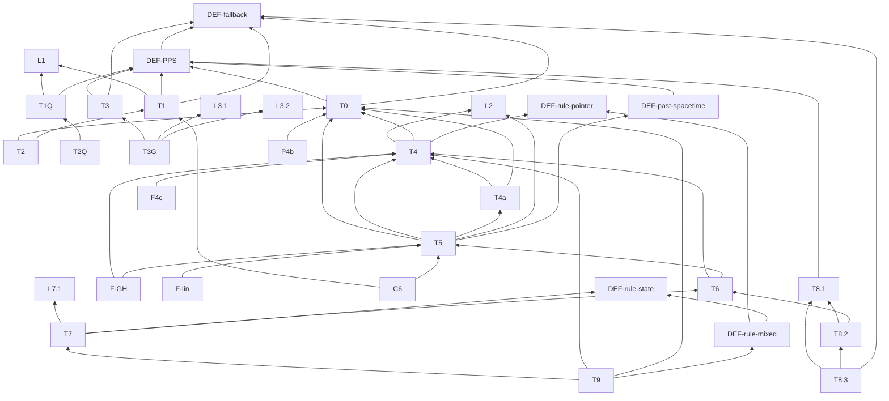

# Theorem ledger

One row per definition, lemma, theorem and finding in [THEOREMS.md](../THEOREMS.md), linked to what it depends on, the code that implements it, and the tests that check it. A second table lists the published results, assumptions and open problems the rows rest on.

Last reviewed against commit `af66bc1` (2026-11-28): static checks pass, and all 26 rows with tests pass.

```text
python -B ctc/ledger/check_ledger.py                       # validate every row (static, under a second)
python -B ctc/ledger/check_ledger.py --run                 # also run each row's test classes (~15 s)
python -B ctc/ledger/check_ledger.py --impact DEF-fallback # everything that depends on an item
python -B ctc/ledger/check_ledger.py --since af66bc1       # rows whose code, tests or doc section changed
python -B ctc/ledger/check_ledger.py --graph               # Mermaid dependency graph
```

## Why

The project changes its definitions as it learns. On 2026-11-27 the paradox-world fallback moved from the D-CTC fixed point to the open loop, and Theorems 1, 3, 6 and 8 had to be reread. The ledger makes that check mechanical:

- `--impact DEF-fallback` lists the 23 rows that depend on the fallback.
- `--since <commit>` maps a diff to rows. A code or test file maps to every row that names it. A change in THEOREMS.md maps only to the rows whose section changed. Both come with their transitive dependents.
- The static check fails when a doc anchor, a function or a test class named in the ledger disappears, so renaming something without updating the ledger is caught.

## Files

| File | Content |
|---|---|
| `theorems.tsv` | 32 rows: 6 definitions, 22 proved statements, 1 proved from published results, 3 numerical findings |
| `inputs.tsv` | 32 rows: 15 published results, 10 assumptions, 7 open problems |
| `check_ledger.py` | validation, test runner, impact and diff queries (standard library only) |

### `theorems.tsv` columns

| Column | Meaning |
|---|---|
| `id` | `DEF-…` definition, `L…` lemma, `T…` theorem, `P…` proposition, `F…` numerical finding, `C…` counterexample |
| `kind`, `title` | type and a one-line statement |
| `doc_file`, `doc_anchor` | a text fragment that must occur in the doc; the row's section runs from it to the next row's anchor |
| `depends_on` | other ledger rows used in the proof or definition |
| `external`, `assumptions` | ids from `inputs.tsv` |
| `code` | `path::function` or `path::Class.method`, separated by `;` |
| `tests` | `path::TestClass`, separated by `;` |
| `status` | `definition`, `proved` (proof in THEOREMS.md, checked by tests), `proved-ext` (the proof also rests on published results not compared with their source), `numerical` (checked by computation only, no proof) |
| `scope` | the conditions under which the statement holds |
| `added` | date the row's section was first written |
| `notes` | what changed, what it supersedes, where it is used |

### `inputs.tsv` columns

| Column | Meaning |
|---|---|
| `kind` | `external` (published result), `assumption` (premise of a theorem), `open` (problem that limits a row) |
| `used_by` | ledger rows that rely on it |
| `source_check` | for published results: `read_in_full`, `partial`, `not_compared` or `classical` (textbook level) |

Three published results are marked `not_compared`: PostBQP = PP, D-CTC = PSPACE, and Deutsch's fixed point. Two of them carry Theorem 8(3). They are the first to check against their sources before the arXiv note.

## Workflow

1. **Before changing a definition**, run `--impact` on it and reread those rows.
2. **When adding a theorem**, add its row, with its tests, in the same commit. The static check fails if a row is marked proved and lists no tests.
3. **Before a release or a hardware run**, run `--run`, then update the reviewed commit at the top of this file.
4. **For a reviewer**, `--since <last reviewed commit>` gives the list of rows to look at.

## Dependency graph

Arrows point from a row to what it depends on. Generated with `--graph`.



## Not covered yet

- The hardware experiments (THEOREMS.md, "Hardware experiments") and the other documents (PAST_PRESERVING.md, T_CTC.md, FIELD_LOOP.md, the timeless models). Add rows when their claims are cited in a paper.
- The checker confirms that the named tests exist and pass. It does not confirm that they test the stated claim. That still needs a reader.
